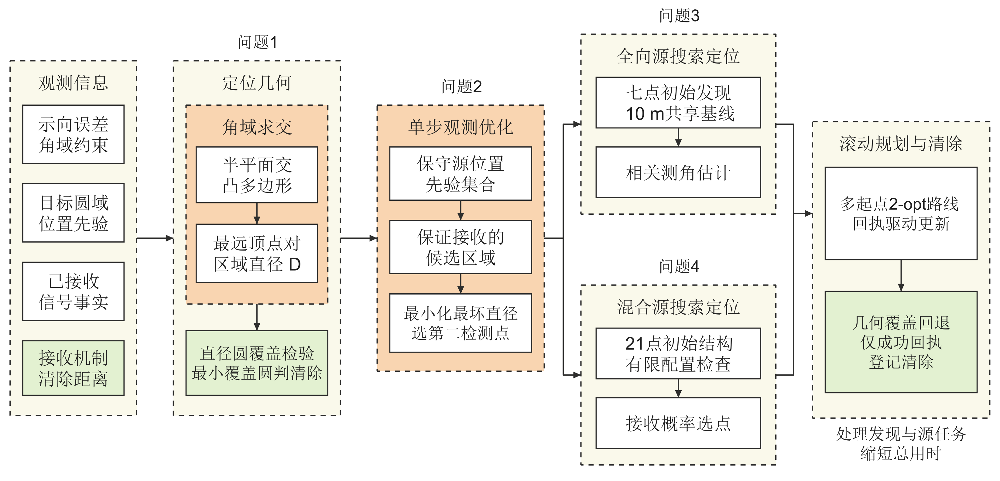

# 数学建模竞赛成果：2026 年 B 题

全国大学生数学建模竞赛 B 题《无线电干扰源的快速自动定位与清除》的团队成果整理，包含最终论文、程序、结果及图表。

本仓库用于赛后成果展示，材料按展示范围独立整理。

## 阅读入口

- [最终论文（正文及完整附录，157 页）](paper/final-paper.pdf)
- [独立附录 A–B（128 页）](paper/appendices.pdf)
- [源代码与配置](support/01_源代码/)
- [计算结果](support/02_结果/)
- [图表总览](support/03_图表/图片与表格总览.pdf)
- [AI 工具使用详情](support/00_说明/AI工具使用详情.pdf)
- [运行环境与复现说明](support/00_说明/运行环境与复现说明.pdf)

## 工作内容

| 问题 | 建模与实现内容 |
|---|---|
| 问题一 | 由方向观测构造定位可行域，研究清除圆的覆盖条件 |
| 问题二 | 比较固定测量规则与自适应测量选点 |
| 问题三 | 结合搜索、测量与执行反馈，组织在线定位与清除流程 |
| 问题四 | 在作业约束下组织覆盖、路线和在线决策 |



## 归档结果

| 问题 | 正式测试场数 | 清除源总数 | 逐场 T/C 的算术平均（秒/源） |
|---|---:|---:|---:|
| 问题三 | 3 | 38 | 231.821154 |
| 问题四 | 3 | 39 | 439.346476 |

逐场数据见 [正式测试结果](support/02_结果/q3_q4/正式测试结果.md)。表中统计量来自既有正式测试记录，并非本次重新运行测试所得；逐场比值的平均不等于总时间除以总源数。正式模式未提供场景总源数，因此不据此宣称清除率 100%、所有场景全清除或全局最优。

## 程序入口

程序与配置保留归档版本。依赖版本见 `support/01_源代码/requirements.txt`，环境说明以随附 PDF 为准。

```bash
cd support/01_源代码
python -m pip install -r requirements.txt
python -B q3_q4/robot.py --check
```

`--check` 用于离线检查冻结源码的哈希与导入。问题三、四的完整运行还需要官方 Windows 模拟器与有效会话；本仓库不提供模拟器或会话身份信息。

问题一、二的程序位于 `q1_q2/`，构造输入位于 `examples/`。

## 整理范围

- 收录最终论文、必要运行代码、配置、结果、图表及 AI 使用说明。
- 不收录原始运行日志、会话凭据、内部协作记录、历史候选方案或论文草稿。
- 这是展示用整理包，不是比赛原始提交压缩包的完整替代品；论文附录可能提及本展示包未收录的证据材料。
- `SHA256SUMS.txt` 记录本地整理文件的校验值。

本项目为团队成果；AI 参与情况保留原始说明。最终论文 PDF 按原字节保存，不声称本目录包含其最终排版源文件。
